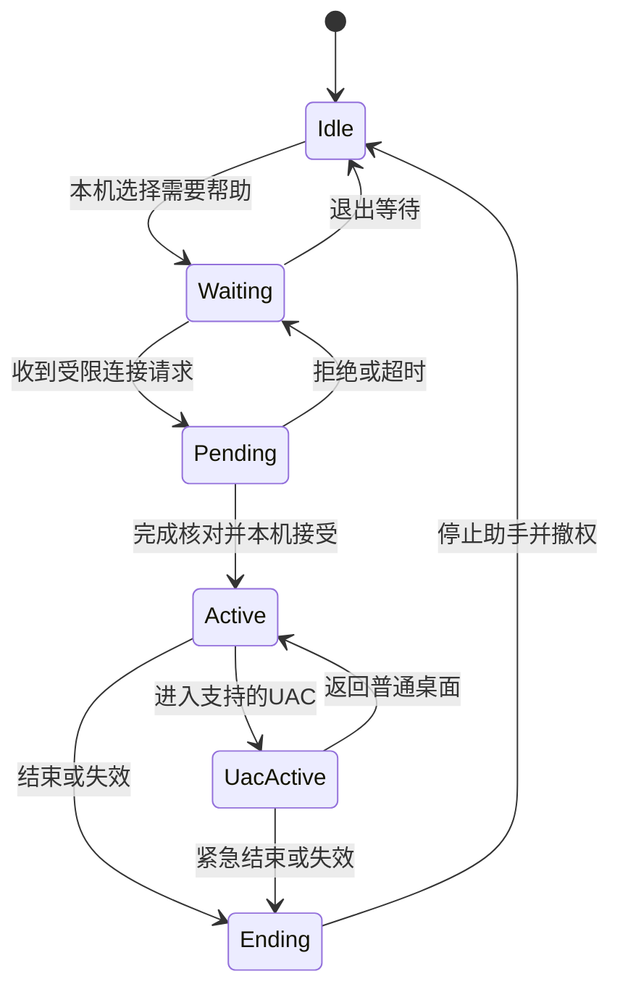
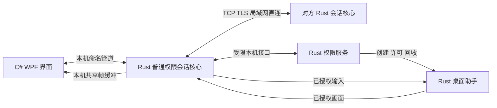

# 局域网远程协助 MVP 需求文档与开发计划

| 项目 | 内容 |
| --- | --- |
| 文档版本 | 1.3 |
| 基线日期 | 2026-10-24，Asia/Taipei |
| 产品阶段 | 面向小范围真实用户试用的 MVP |
| 目标平台 | Windows 10 22H2 x64 |
| 保存位置 | Version/Minimun Viable Product/plan |
| 需求来源 | 本项目七个议题的讨论与明确选择 |
| 第二台测试电脑 | 待查 |
| 实现与验收状态 | 尚未开始实现；性能与稳定性指标均为待实测的验收目标 |

本项目要交付一款局域网内的一对一远程协助软件。熟悉电脑的人帮助家人或熟人，在对方每次现场同意后操作其当前桌面，完成 Office 文档编辑和 Bing 搜索“计算机”等网页操作。双方使用同一个软件，通过“我需要帮助”和“帮助他人”两个入口进入相应流程。

第一版包含普通桌面操作和管理员账号下 UAC“是／否”确认，支持主显示器、中文输入、局域网自动发现及手动 IP 连接。目标是在登记的双机环境中达到真实 1080p 动态画面平均至少 30 FPS、操作反馈 P95 不超过 150 毫秒，并通过连续 1 小时和 20 轮连接结束测试。

**已确认的联网硬约束：远控软件及其依赖零公网外联。** 屏幕、输入、认证信息、设备及连接元数据、日志和诊断信息均只在本机或允许的局域网两端之间处理。浏览器、Office 和 Windows 自身的独立联网另行管理，网页浏览测试继续保留。

需求、默认参数和验证结论分别管理。开发可以按本文的实施默认值推进；涉及用户已确认边界、认证机制或验收门槛的调整，必须先更新决策记录，保留原因与影响。未测项目不能填写“通过”。

**阅读导航**

- 产品与使用：[决策基线](#第一章-产品定义与决策基线)、[任务与流程](#第二章-典型使用任务与完整使用流程)、[功能边界](#第三章-功能需求与边界)、[状态与异常](#第四章-会话状态与异常流程)、[环境与设备](#第五章-环境与测试设备)。
- 技术与质量：[架构](#第六章-技术架构与数据流)、[授权与安全](#第七章-授权与安全要求)、[部署](#第八章-安装部署与试用分发)、[性能标准](#第九章-性能与稳定性验收标准)、[接口契约](#第十章-接口契约与实现约束)。
- 实施与交付：[开发阶段](#第十一章-分阶段开发计划)、[测试矩阵与用例](#第十二章-测试矩阵与验收用例)、[风险与待查](#第十三章-风险与待查事项)、[发布检查](#第十四章-交付与发布检查)、[参考与变更](#第十五章-参考资料与基线变更记录)。

## 第一章 产品定义与决策基线

### 产品目标

1. 验证从发现设备、核对连接、现场授权到完成真实任务的完整闭环。
2. 验证 Windows 普通桌面、管理员应用和 UAC 安全桌面之间的采集与输入能力。
3. 让目标用户按简明说明完成日常协助，无需开发人员临时改代码、改注册表或敲命令。
4. 建立可重复的质量证据，为后续版本决定性能优化和功能扩展方向。

本轮验证针对两台登记的 Windows 10 22H2 x64 测试电脑。实际硬件最低要求在双机实测后确定，不能从一台开发电脑的运行结果推定所有 Windows 电脑均兼容。

### 角色与术语

| 术语 | 定义 |
| --- | --- |
| 协助方 | 发起连接、查看画面并执行远程操作的人 |
| 被协助方 | 在本机接受请求、提供当前桌面并保留终止权的人 |
| 控制端 | 当前承担协助方角色的应用实例 |
| 被控端 | 当前承担被协助方角色的应用实例 |
| 等待协助 | 用户主动开放本次接收请求的状态 |
| 校验码 | 双方核对当次连接所用的短认证字符串，不是永久密码 |
| 会话授权 | 被协助方对特定连接、特定本机登录会话的一次性许可 |
| 普通桌面 | 当前已登录用户日常使用的交互桌面 |
| 安全桌面 | Windows 用于 UAC 等系统界面的受保护桌面 |
| P95 | 样本按耗时从小到大排列后，至少 95% 样本不超过的值 |
| 有效新帧 | 控制端实际呈现的新的被控画面，排除重复帧和仅发送但未呈现的帧 |

### 状态标记

| 标记 | 使用方式 |
| --- | --- |
| 已确认 | 用户在七个议题中明确选择或接受的要求 |
| 实施默认值 | 为使开发可执行而确定的参数和工程细节，不冒充用户逐项确认 |
| 待查 | 当前缺少的事实，例如第二台电脑的配置 |
| 待验证 | 需要原型或实测给出结论的技术能力 |
| 不纳入首轮 | 不属于当前兼容保证或验收范围，不代表永久放弃 |

### 七个议题的结论

| 议题 | 已确认的主要结果 | 本文位置 |
| --- | --- | --- |
| 典型任务 | 帮助家人或熟人，操作 Office 文档并使用 Bing 搜索“计算机” | 第二章 |
| 完整流程 | 同一软件两个入口，自动发现优先、手动 IP 备用，现场接受、双方可结束 | 第二章、第四章 |
| 功能边界 | 主屏、鼠标键盘、中文、远端内部复制粘贴；支持 UAC“是／否”及管理员应用 | 第三章 |
| 支持环境 | Windows 10 22H2 x64，同一 IPv4 网段，有线、Wi-Fi、混合连接，720p／1080p 与三档缩放 | 第五章 |
| 技术路线 | 自建应用与核心，使用成熟库；C#/.NET 界面、Rust 核心；本机组词后发送确定文字 | 第六章 |
| 授权安全部署 | 双方核对当次校验码，本次授权包含 UAC；远控软件及依赖零公网外联；首轮未签名受控试用 | 第七章、第八章 |
| 性能稳定验收 | 1080p 平均至少 30 FPS，反馈 P95 不超过 150 毫秒，连续 1 小时及 20 轮连接结束 | 第九章、第十二章 |

### 实施默认值总览

以下参数用于开发基线。后续章节给出约束和验收方法。

| 项目 | 默认值或规则 |
| --- | --- |
| 界面框架 | WPF，目标 .NET Framework 4.8 |
| Rust 目标 | x86_64-pc-windows-msvc |
| 会话传输 | 一个 TCP TLS 连接，控制消息与画面分片逻辑分流 |
| 加密实现 | Rustls，TLS 1.3；不启用控制指令的早期数据与授权自动恢复 |
| 自动发现 | 同一允许接口上的 IPv4 UDP 广播与应答 |
| 开发默认端口 | TCP 45880；UDP 45881，应用、安装器和测试配置使用同一来源 |
| 并发 | 每台被控电脑最多一个活动会话、一个待确认请求 |
| 待确认超时 | 60 秒；超时后关闭该连接，可重新发起 |
| 请求限速 | 每个源 IP 每分钟最多 5 次待核对握手，全局每分钟最多 10 次 |
| 校验码显示 | 默认 8 位十进制数字，分为两组；认证协议通过评审后冻结 |
| 心跳与撤权 | 每秒心跳，连续 3 秒无有效响应判为失联，总停止时限不超过 5 秒 |
| 紧急终止键 | 默认 Ctrl+Alt+Shift+F10；普通桌面与 UAC 桌面均须验证 |
| 后台服务 | 安装后自动启动并保持空闲；可见应用手动打开 |
| 网络策略 | 软件及依赖零公网外联；发现和会话双向限制到允许的专用局域网接口、对端及必要端口 |
| 更新方式 | 首轮手动安装更新，不建设在线自动更新系统 |
| 日志 | 本机轮转日志，默认 5 个文件、每个最多 5 MiB，手动导出 |
| 帧共享 | 命名管道传控制与状态；控制端原始画面采用受限的本机共享内存三缓冲 |
| 图像编码 | JPEG 用于早期验证；达不到完整指标时优先评估 Media Foundation 低延迟 H.264 |

端口占用时显示明确错误并停止进入等待状态，不自动尝试公网端口或扫描任意端口。更改默认端口必须同步安装规则、发现协议、手动地址解析和测试配置。

## 第二章 典型使用任务与完整使用流程

### 使用场景前提

双方处于同一 IPv4 网段并可互访。被协助方已经登录 Windows，现场有人可以打开软件、核对校验码并接受请求。Office 和浏览器由被控电脑正常运行，本产品通过当前桌面操作它们，不需要 Office 插件或 Bing 专用接口。

远控软件及其依赖必须在无公网条件下完整工作，并且在公网可用时也不得发起任何公网通信。Bing 搜索任务由被控电脑的浏览器独立访问网站；浏览器、Office 和 Windows 自身的独立联网另行管理。该区分不允许远控软件委托其他进程或代理替它外传数据。网站自身不可访问应先作为测试环境问题排查；断公网验收使用预先准备的本地测试网页。

### 任务一 Office 文档编辑

| 项目 | 约定 |
| --- | --- |
| 用户目标 | 帮家人或熟人修改一份文字材料并保存 |
| 首轮应用 | Word 2024，作为 Office 文档任务的具体测试基线 |
| 初始状态 | 被控电脑已安装 Word，准备专用测试文档 |
| 操作 | 打开文档、定位内容、输入中文英文数字标点、选择文字、复制剪切粘贴、撤销、保存 |
| 快捷键 | Ctrl+A、Ctrl+C、Ctrl+X、Ctrl+V、Ctrl+Z、Ctrl+S |
| 完成标准 | 文字可辨认，输入无遗漏或重复，保存后重新打开与预期内容一致 |
| 文件位置 | 全部位于被控电脑本地；跨电脑文件传输不属于此任务 |
| 证据 | 用例结果、预期文本与实际保存内容核对、相关错误码和性能统计 |

测试文档使用固定且不含真实个人信息的内容，覆盖中文、英文、数字、标点、换行和相近字形。保存正确性与画面可读性分别检查，二者都必须通过。

### 任务二 Bing 搜索与结果浏览

| 项目 | 约定 |
| --- | --- |
| 用户目标 | 帮对方使用 Bing 搜索“计算机”并查看结果 |
| 测试入口与搜索词 | https://www.bing.com/；固定搜索词为“计算机” |
| 首轮浏览器 | Edge 和 Chrome |
| 初始状态 | 被控端本机已确认网站可访问，页面可以正常加载 |
| 操作 | 打开 Bing，点击搜索框，通过控制端中文输入法输入“计算机”，提交搜索，滚动查看结果，打开一条已登记的普通结果，再通过浏览器界面返回 |
| 完成标准 | 搜索词输入准确且无重复，结果页正确显示查询内容，文字可读，点击与滚动正常，能够完成结果打开与返回 |
| 性能测量 | 在已加载的搜索结果页上连续上下滚动；搜索请求、网页下载与目标网站响应时间另记 |
| 复制粘贴 | 可以将被控浏览器中的文字复制到同机 Word，不读取控制端剪贴板 |

测试准备时确认 Bing 及选定的普通结果链接可访问，记录访问日期、实际入口 URL、地区跳转和结果链接。搜索排名、标题和页面布局可能变化，不要求不同测试日期的结果完全相同；验收以搜索操作及结果浏览能否完成为准。结果页稳定后再采集动态帧率，不把外部网站加载耗时计作远控回显延迟。

### 技术验收任务 UAC 与管理员应用

该任务用于证明必需的权限能力，不扩展为软件安装管理产品。

1. 在已接受的协助会话中触发一次管理员权限请求。
2. 控制端看到默认安全桌面上的 UAC“是／否”界面。
3. 选择“是”后，能够操作以管理员身份运行的测试应用。
4. 选择“否”后，普通桌面会话仍可正常使用。
5. UAC 显示期间，被协助方能够使用本机紧急终止方式撤销本次协助。

标准账号输入管理员账号密码、登录画面控制及跨用户登录不属于本轮任务。

### 首次安装流程

1. 双方取得同一版本的试用安装包、说明与 SHA-256 校验值。
2. 本机用户核对分发来源和文件一致性，启动安装程序。
3. 本机管理员确认 Windows 安装授权。
4. 安装应用、Rust 服务及助手组件，建立专用网络的受限防火墙规则。
5. 检查后台服务与运行依赖，提供可见应用入口和卸载入口。
6. 用户手动打开应用，进入角色首页。

初次安装的管理员授权由本机完成，不尝试通过尚未建立的远控会话替用户批准安装自身。

### 日常协助流程

| 步骤 | 被协助方 | 协助方 | 系统行为 |
| --- | --- | --- | --- |
| 打开 | 点击“我需要帮助” | 点击“帮助他人” | 显示对应角色页面 |
| 准备 | 进入等待状态，看到名称、地址和结束等待入口 | 查看等待设备列表 | 只在允许接口发布等待信息 |
| 请求 | 等待连接提示 | 选择设备，找不到时输入 IPv4 或 IPv4:端口 | 建立待验证加密连接 |
| 核对 | 查看当次校验码 | 查看自己的当次校验码 | 两端码来自同一次认证过程 |
| 接受 | 核对后点击“已核对，允许协助”，或拒绝 | 等待对方接受 | 许可明确包含桌面与 UAC 操作 |
| 操作 | 看见自己的当前桌面及协助状态，保留本机输入 | 操作文档、浏览器和必要权限界面 | 通过授权后才开放画面与输入 |
| 结束 | 点击结束或使用紧急终止 | 也可主动结束 | 清空权限和缓冲，停止会话助手 |

在结束一轮协助后，被控端回到“未开放协助”状态。下一轮由本机用户再次点击“我需要帮助”，避免结束后继续接收意料之外的请求。请求被拒绝或超时则回到原等待状态，等待者可以随时退出。

## 第三章 功能需求与边界

### 必需功能

| 编号 | 需求 | 行为与通过条件 |
| --- | --- | --- |
| FR-01 | 同一应用两个角色入口 | 双方使用同一安装包，可以选择当前角色 |
| FR-02 | 主动等待协助 | 本机主动开启后才发现与接收；退出等待后停止开放 |
| FR-03 | 自动发现 | 列出允许专用网络内正在等待的设备，显示名称与地址 |
| FR-04 | 手动地址连接 | 自动发现失败时，IPv4 或 IPv4:端口可以发起同等授权流程 |
| FR-05 | 当次连接核对 | 双方显示连接绑定的校验码，被控端可明确接受或拒绝 |
| FR-06 | 主屏实时画面 | 查看当前主显示器，能够辨认文档、光标、菜单、弹窗 |
| FR-07 | 鼠标操作 | 支持移动、左键、右键、双击、滚轮、拖动和文字选择 |
| FR-08 | 文字与编辑输入 | 支持中英文、数字、标点、常用编辑键和已列出的编辑快捷键 |
| FR-09 | 本机中文组词 | 在控制端完成组词，将确定的 Unicode 文字输入远端一次 |
| FR-10 | 远端内部复制粘贴 | 被控电脑上的应用之间可正常复制粘贴，不共享两机剪贴板 |
| FR-11 | 远程窗口显示 | 支持适应窗口和原始像素显示；窗口缩放后坐标正确 |
| FR-12 | UAC 同意与拒绝 | 支持已登录管理员账号的 UAC“是／否”及随后管理员应用操作 |
| FR-13 | 状态与主动结束 | 双方可见状态，双方均可结束；本机终止覆盖 UAC 期间 |
| FR-14 | 异常恢复入口 | 发现失败、拒绝、超时、失联均有明确提示及适当重试入口 |
| FR-15 | 安装与清理 | 安装、失败回滚、更新前结束会话、卸载清理均可验证 |
| FR-16 | 本地诊断 | 提供不含业务内容的运行与性能日志，可手动导出 |

原始像素显示与适应窗口属于显示实现默认值。原图大于视区时允许滚动查看；缩小到整个桌面时仍要保持比例并保证坐标映射正确。

### 键盘处理范围

第一版覆盖字母数字、确定文本、Enter、Tab、Esc、Backspace、Delete、方向键、Home、End、PageUp、PageDown，以及文档编辑所需的 Ctrl、Shift、Alt 组合。

控制端输入分成“确定文本”和“物理按键／组合键”两条路径。同一个可打印字符不能先发送原始字母，再发送一次输入法确定文本。输入法正在组词时，候选与组词操作由控制端处理；确定文字后才发送文本事件。

Ctrl+C 和 Ctrl+V 在远程视图获得控制焦点时作用于被控电脑。本机输入法候选界面和软件自身输入框使用本机输入。远程视图失去焦点、结束或失联时，释放已注入的修饰键和鼠标按钮。

系统级快捷键 Ctrl+Alt+Del、Win+L、远端 Alt+Tab 等不纳入首轮支持清单。通过被控任务栏或窗口界面切换应用。不会以全局接管控制端键盘作为默认交互。

### UAC 范围

本轮仅保证已登录管理员账号下的同意型 UAC。进入安全桌面后，只允许“是／否”操作及必要的鼠标和导航确认键；不提供管理员凭据输入能力。

用户首次接受本次协助时已明确授权远程 UAC 操作，但 Windows 对各个应用的 UAC 提示仍正常出现。安装服务并不构成以后自动接受新协助的授权。

锁屏、注销、切换用户与 UAC 是不同事件。前者必须结束会话；后者在当前会话仍有效、未锁定且可识别为支持的 UAC 界面时继续。不能仅因“进入了安全桌面”就放行采集和输入。

### 不纳入首轮的功能

| 类别 | 不纳入内容 |
| --- | --- |
| 平台 | Windows 11、Windows ARM64、32 位 Windows、其他操作系统 |
| 网络 | 禁止公网连接、穿透和中继；跨子网或 VLAN 不纳入首轮兼容范围 |
| 会话 | 无人值守、永久访问密码、登录前控制、锁屏登录、重启自动重连、多方同时控制 |
| 屏幕 | 副屏选择、跨屏操作、同时展示多个显示器、2K／4K 验收 |
| 数据协作 | 跨电脑剪贴板、图片共享、文件传输、文件同步 |
| 媒体 | 音频、摄像头、产品内录屏、游戏或高帧率视频专项优化 |
| 权限 | 标准账号输入管理员凭据、凭据保存、远程绕过初次本机安装授权 |
| 运维 | 云账号、设备管理后台、永久信任白名单、在线自动更新 |

这些边界约束第一版的实现与交付。候选的本地文件整理任务未被选为独立验收任务，文档保存所需的文件操作仍正常保留。

## 第四章 会话状态与异常流程

### 状态模型

Idle、Waiting、Pending、Active、UacActive 和 Ending 分别对应未开放、等待、待验证、协助中、UAC 协助中和清理中。状态以被控端的本地授权为最终依据，控制端界面不能单方面宣布已获得权限。

| 状态 | 可以执行 | 必须禁止 |
| --- | --- | --- |
| Idle | 打开角色页面、安装检查、查看设置 | 发布接收协助信息、网络控制、采集传输 |
| Waiting | 受限发现与请求处理 | 发送桌面画面、执行远程输入 |
| Pending | 最小元数据、认证消息、显示核对界面 | 桌面传输、文字鼠标注入、启动可操作的权限助手 |
| Active | 已授权的主屏画面、普通输入、申请进入支持的 UAC 状态 | 文件传输、跨账号控制、额外未授权能力 |
| UacActive | 支持的权限确认、必要导航、本机紧急结束 | 凭据型 UAC 文本输入、锁屏登录操作 |
| Ending | 撤权、释放按键、停止助手、清理画面与连接 | 新增输入、恢复旧会话、继续使用旧令牌 |

### 异常处理

| 异常 | 用户反馈 | 处理 |
| --- | --- | --- |
| 未发现设备 | 未找到等待协助的电脑 | 刷新或手动地址，不将发现失败等同于授权失败 |
| 地址错误或端口不通 | 无法连接目标地址 | 说明地址、等待状态和网络条件的检查项，允许重试 |
| 不在允许网络 | 当前接口不满足本轮网络条件 | 停止开放，提供专用网络设置说明，不自动修改类别 |
| 请求被拒绝 | 对方拒绝了本次协助 | 关闭本次连接，被控端保留原等待状态 |
| 核对不一致 | 本次连接未通过核对 | 立即关闭，不提供忽略后继续控制的入口 |
| 等待超时 | 本次请求已超时 | 关闭待确认连接，旧请求与旧授权均失效 |
| 目标正在协助 | 对方正在进行另一轮协助 | 拒绝额外活动会话，不抢占原会话 |
| 普通网络失联 | 连接已中断，需要重新发起 | 到时撤权，恢复网络不自动恢复控制 |
| 界面或核心崩溃 | 对端显示连接结束或失联 | 服务独立回收权限助手，不依赖崩溃进程通知 |
| 不支持的 UAC | 此权限确认需要本机处理 | 停止该安全桌面操作，由本机取消或结束协助 |
| 锁屏或用户变化 | 本次协助已因用户会话变化结束 | 撤权并返回未开放状态 |
| 显示模式变化 | 显示配置变化，本次协助结束 | 停止输入并重连，避免继续使用旧坐标 |
| 不支持的分辨率 | 当前配置不在首轮范围 | 显示支持的配置；首轮默认拒绝开始协助 |
| 编码或采集失败 | 无法继续提供有效画面 | 结束控制，显示错误码，保留无内容日志 |
| 安装不完整 | 组件检查未通过 | 提供修复或重新安装入口，不能静默缺失安全能力 |

本轮显示配置在单次会话内保持固定。UAC 桌面切换必须恢复；主动更改被控端分辨率、DPI 或主屏属于显示模式变化，采用结束后重新连接的默认行为。

## 第五章 环境与测试设备

### 首轮保证范围

| 项目 | 范围 |
| --- | --- |
| Windows | Windows 10 22H2 x64 |
| 用户 | 已登录管理员账号；日常界面按普通权限运行 |
| 网络 | 同一 IPv4 网段，互相可达 |
| Windows 网络类别 | 承载协助的接口为专用网络 |
| 接入方式 | 有线、有线与 Wi-Fi 混合、Wi-Fi |
| 屏幕 | 只控制主显示器，横向 1280×720 或 1920×1080 |
| 系统缩放 | 100%、125%、150% |
| Office | Word 2024 作为具体测试应用 |
| 浏览器 | 登记版本的 Edge 与 Chrome |
| 中文输入法 | 控制端 Windows 自带微软拼音作为首轮输入法基线 |
| UAC | 默认安全桌面设置，同意型“是／否”提示 |
| 并发 | 一对一、每个被控实例一个活动会话 |

### 测试电脑 A

以下为本机读取到的环境快照。开始最终测试时重新登记实际版本、驱动和运行条件。

| 项目 | 当前信息 |
| --- | --- |
| 系统 | Windows 10 Pro 22H2 x64 |
| 构建 | 19045.7807 |
| CPU | Intel Core i5-1035G1，报告基础频率 1.00 GHz |
| 逻辑处理器 | 8 |
| 已安装物理内存 | 16 GiB |
| 报告的显示驱动 | Intel UHD Graphics；ToDesk Virtual Display Adapter |
| 当前主屏 | 1920×1080 |
| 当前缩放 | 150% |
| Office | Office Professional Plus 2024 x64，16.0.20326.20232 |
| Chrome | 155.0.8059.85 |
| Edge | 149.0.4022.98 |
| 网络类别观察 | 同时存在已连接的专用与公用网络 |
| 承载最终测试的网卡与路由器 | 待登记 |
| 显卡驱动版本与实际编码能力 | 待验证 |

基础频率不是测试时的实际工作频率。现有虚拟显示驱动可能影响 DXGI 输出选择，M0 必须确认捕获的是当前活动主屏及其适配器。测试报告记录与其他远控或虚拟显示组件的共存情况，不把其他软件的结果作为本产品的通过证据。

### 测试电脑 B

| 项目 | 当前信息 |
| --- | --- |
| 是否已经准备就绪 | 待查 |
| Windows 版本、版本号与构建 | 待查 |
| 架构 | 待查 |
| CPU 与逻辑处理器 | 待查 |
| 内存 | 待查 |
| GPU 与驱动 | 待查 |
| 主屏分辨率与可用显示模式 | 待查 |
| 显示缩放 | 待查 |
| Office 与浏览器版本 | 待查 |
| 中文输入法 | 待查 |
| 有线及 Wi-Fi 条件 | 待查 |
| 专用网络与同网段互访 | 待查 |
| 本机安装授权条件 | 待查 |
| 是否可执行 UAC 安全桌面测试 | 待查 |

电脑 B 到位前，可以完成需求整理、构建、本机原型和开发环境预检。双机性能、真实网络矩阵和最终发布验收继续标为待验证。

### 构建环境基线

本机已发现 .NET SDK 9.0.314、Rust 1.96.0、Cargo 1.96.0，Rust 当前目标为 stable-x86_64-pc-windows-msvc。系统具有 .NET Framework 4.x。

M1 验证 .NET Framework 4.8 目标引用程序集、MSVC 链接器、Windows SDK、依赖恢复及离线运行所需文件。开发 SDK 与最终用户运行时分开登记；最终用户不需要安装 Rust、Cargo 或 .NET SDK。

Windows 10 22H2 预装 .NET Framework 4.8，是本轮界面目标选择的依据。[微软兼容说明](https://learn.microsoft.com/en-us/dotnet/framework/get-started/system-requirements)

## 第六章 技术架构与数据流

### 总体路线

采用自主应用和自主会话核心，复用成熟系统接口与库，不将现有远控软件作为运行后端。用户已接受所选开源依赖的相应源码提供要求；项目原创代码与文档已选定 GNU GPL 第 3 版，仅限此版本（GPL-3.0-only），完整正文见仓库根目录 LICENSE。第三方组件保留各自许可证，集成与分发时继续核对兼容性和对应源码提供安排。

界面采用 C#、WPF 和 .NET Framework 4.8。Rust 实现设备发现、会话、加密传输、采集、编码解码、输入和权限管理。Windows 接口通过微软 windows-rs 访问，网络异步处理使用 Tokio，TLS 使用 Rustls；具体稳定版本由 M1 验证并锁定。[windows-rs](https://github.com/microsoft/windows-rs)、[Rustls](https://github.com/rustls/rustls)、[Tokio 命名管道](https://docs.rs/tokio/latest/tokio/net/windows/named_pipe/index.html)

### 组件职责

| 组件 | 权限与生命周期 | 主要责任 |
| --- | --- | --- |
| Desktop UI | 当前用户普通权限，用户手动启动 | 角色入口、列表、核对与本机授权、远程显示、输入法、状态与结束 |
| Session Core | 普通权限，由 UI 启动并绑定其生命周期 | UDP 发现、TCP TLS、会话状态、协议校验、媒体接收、遥测 |
| Broker Service | LocalSystem，安装后空闲运行 | 校验本机调用方、管理会话许可、创建与回收固定助手、独立看门狗 |
| Desktop Helper | 位于目标登录会话，由服务受控创建 | DXGI 采集、必要编码、SendInput、安全桌面处理、紧急终止 |

Rust 同一工作空间内构建核心、服务和助手角色。可使用同一核心可执行文件的固定角色参数运行不同进程；系统服务和普通进程不得靠一个权限不断切换的界面进程混用。

服务只接受固定类型的本机请求，没有网络控制监听口，不提供任意命令、任意可执行路径或脚本执行接口。服务在 Session 0，桌面助手在受控的当前交互会话；实际桌面工作不能直接由服务界面承担。[微软服务隔离说明](https://learn.microsoft.com/en-us/windows/win32/services/interactive-services)

### 逻辑结构

图中的箭头表示逻辑数据和控制关系。每条本机通道均须绑定正确登录会话与进程身份，不能仅凭一个进程提供的名称或会话编号建立信任。

### 画面采集

使用 Direct3D 11 与 DXGI Desktop Duplication 获取主屏画面及光标信息。采集线程使用有限等待，能及时响应停止和桌面切换；不使用不可取消的无限等待妨碍撤权。桌面切换使采集接口失效时，释放旧资源并重建。[DXGI 帧获取约束](https://learn.microsoft.com/en-us/windows/win32/api/dxgi1_2/nf-dxgi1_2-idxgioutputduplication-acquirenextframe)

采集与输入统一以被控主屏物理像素为基础，保留分辨率、帧代号和显示代号。鼠标光标若由 DXGI 单独提供，则在控制端正确合成，避免重复或丢失。静止桌面降低无效采集和发送，动态画面按验收要求更新。

### 编码与解码

编码路径分成两个阶段，保留统一的媒体接口：

1. JPEG 独立帧用于最早的画面、授权、输入、坐标和端到端链路验证。
2. 在 1080p 基准上测量是否满足 NFR-01 与 NFR-02。若满足全部质量和稳定性指标，可以作为 MVP 编码；若不满足，按瓶颈数据优先实现 Media Foundation 低延迟 H.264。
3. H.264 优先使用实际设备可用的硬件变换；缺少硬件能力时验证软件路径，记录选择结果和实际性能。
4. H.264 编解码由 Rust 负责，解码后向 UI 提供统一的 BGRA 画面；UI 不承担网络视频协议。
5. 桌面切换、重建编码器或新建会话时提供可解码的初始化信息与关键帧。不能把旧流的预测帧接到新流上。
6. 丢帧优先发生在采集后、编码前。采用帧间编码时，丢弃已编码依赖帧必须配套解码器重置与关键帧恢复，不能沿用 JPEG 的任意丢帧方式。

Media Foundation 提供 H.264 编码、解码及低延迟属性，但设备能力和属性行为需要实测。低延迟属性对部分实现的取值类型也有差异，须按实际变换配置和验证。[编码器](https://learn.microsoft.com/en-us/windows/win32/medfound/h-264-video-encoder)、[解码器](https://learn.microsoft.com/en-us/windows/win32/medfound/h-264-video-decoder)、[低延迟属性](https://learn.microsoft.com/en-us/windows/win32/medfound/codecapi-avlowlatencymode)

不会通过将 1080p 降成 720p、降低文字可读性或仅统计编码输出帧来达成指标。性能报告记录编码器名称、实际编码分辨率、质量或码率、关键帧设置及解码路径。

### 线程与缓冲

采集、编码、网络读写、解码和 UI 呈现分离。控制指令和停止事件拥有高于普通视频分片的发送优先级；不在 UI 线程执行阻塞网络、等待编码或服务调用。

应用队列有明确容量：采集待编码队列最多保留最新一帧，媒体发送队列最多保留两个完整待发送帧。达到上限时按编码依赖规则处理，不能无限堆积旧画面。停止流程先撤销权限，再丢弃队列和清理资源，不等待全部旧帧发送完成。

本机 IPC 默认使用命名管道传递控制、状态和帧就绪通知。为适应 30 FPS，Rust 解码结果与 WPF 之间使用受限共享内存三缓冲：生产者只写空闲槽，消费者完成拷贝后确认释放，任何正在读取的槽都不能覆盖。

1920×1080 的 BGRA 帧为 8,294,400 字节，30 帧每秒仅像素量约为 237 MiB/s。这是容量推算，说明本机画面路径需要控制拷贝次数，不是实测带宽或零拷贝承诺。

### 坐标与输入

显示层计算原图到视口的缩放、偏移和裁剪。输入时使用逆变换还原被控物理坐标；黑边、工具栏和软件自身控件不产生远程点击。窗口变化后更新变换，旧显示代号的输入不得套用到新画面。

Rust 助手使用 SendInput 处理鼠标、按键和 Unicode 文本。接口受到权限与桌面边界限制，使用系统权限助手并不消除对当前登录会话和授权状态的检查。[输入权限说明](https://learn.microsoft.com/en-us/windows/win32/api/winuser/nf-winuser-sendinput)

控制端 WPF 使用原生输入法组合事件，只将确定文本作为文本事件。普通编辑键和快捷键走按键事件；远程控制焦点、本机软件输入框和输入法候选状态分别处理。Unicode 输入采用系统支持的方式，不通过改写两台电脑的剪贴板实现。[Unicode 输入接口](https://learn.microsoft.com/en-us/windows/win32/api/winuser/ns-winuser-keybdinput)

### UAC 与进程回收

UAC 必须在默认安全桌面设置下通过。DXGI 对安全桌面访问有系统权限要求，单纯将普通界面设为“以管理员身份运行”不能作为完整方案。[采集权限说明](https://learn.microsoft.com/en-us/windows/win32/api/dxgi1_2/nf-dxgi1_2-idxgioutput1-duplicateoutput)

服务创建绑定当前登录会话的助手，维护短期许可与独立看门狗。助手只接受本次许可范围内的采集和输入；每次执行前重新检查会话是否有效。正常结束、租约失效或服务异常时，应通过进程句柄、Job Object 等受控机制回收助手。

UAC 模式的放行至少同时满足：登录用户未变化、会话未锁定、原连接仍有效、当前安全界面被识别为支持的同意型 UAC。无法明确分类时结束远程操作，避免把锁屏或登录界面当成 UAC。

紧急终止方式在普通桌面和 UAC 期间均须原型验证。默认 Ctrl+Alt+Shift+F10；注册失败、冲突或无法覆盖安全桌面时，不宣称 UAC 功能通过。快捷键在软件自身输入转发之前处理，远程输入不得屏蔽本机终止能力。[系统热键接口](https://learn.microsoft.com/en-us/windows/win32/api/winuser/nf-winuser-registerhotkey)

## 第七章 授权与安全要求

### 保护目标与边界

本轮保护屏幕内容、输入能力、本地会话许可、临时密钥和系统权限组件，主要处理局域网中的错误连接、冒充名称、篡改或重放请求、旧权限残留、未受限的本机服务调用与异常输入。

安全基线假定 Windows 本身及本机管理员可信。不能将应用级控制描述为能够抵抗已控制同一账号或系统管理员的恶意软件。被授权的人本来就能够看到并操作被分享的桌面，因此本机明确同意、随时撤销和权限生命周期是必要保护。

### 安全需求

| 编号 | 要求 | 通过条件 |
| --- | --- | --- |
| SEC-01 | 未授权不开放 | 核对及本机接受之前，画面、输入和权限助手操作均受禁止 |
| SEC-02 | 当次对象核对 | 认证结果绑定实际连接、会话上下文和双方角色，不能只靠名称或 IP |
| SEC-03 | 加密传输 | 控制与媒体处于同一合格 TLS 会话中，错误握手不得继续 |
| SEC-04 | 抗重放 | 旧连接、旧许可、旧核对消息不能授权新会话 |
| SEC-05 | 明确权限范围 | 本机接受页同时说明画面、输入、UAC 和结束方式 |
| SEC-06 | 可独立撤销 | 结束、失联、崩溃和用户会话变化后，服务能够独立撤权 |
| SEC-07 | UAC 本机终止 | 安全桌面期间仍可本机可靠结束，普通悬浮条不是唯一手段 |
| SEC-08 | 最小网络暴露 | 只在等待与活动状态使用允许专用接口和所需端口 |
| SEC-09 | 本机接口受限 | 校验调用方真实身份与登录会话，只接受固定命令和边界内参数 |
| SEC-10 | 输入与帧受限 | 非法长度、维度、坐标、类型、速率和状态消息不能激活额外能力 |
| SEC-11 | 内容不入日志 | 不记录屏幕、输入文本、校验码、临时私钥和管理员凭据 |
| SEC-12 | 失败时收回权限 | 缺失安全能力、无法分类桌面或服务失效时停止控制 |
| SEC-13 | 软件及依赖零公网外联 | 安装、运行、诊断、更新和卸载均不发起公网通信或通过代理外传；断公网仍能完成本地协助；有公网时也无外联尝试 |

### 校验码认证设计

用户体验固定为“双方看到当次校验码，核对后被控方接受”。短码不是固定设备口令，不在 UDP 发现中广播，也不作为媒体加密密钥。

TLS 先建立受隔离的待验证连接。临时证书可由软件本地生成，私钥仅服务于本次等待和活动会话；本机用户无需购买会话证书或导入全局根证书。待验证阶段保留握手签名、算法与消息完整性检查，应用数据能力保持关闭。

核对值需要与实际承载画面和输入的连接绑定。Rustls 提供连接导出接口，TLS 通道绑定亦有标准定义，但这些接口本身不等同于完整的短码认证协议。[Rustls 导出接口](https://docs.rs/rustls/latest/rustls/struct.ConnectionCommon.html#method.export_keying_material)、[TLS 通道绑定](https://www.rfc-editor.org/rfc/rfc9266.html)

**安全设计门槛：不能直接截短静态证书指纹或一个可由攻击者自适应搜索的握手值，就宣称短码可以抵抗中间人。** 短认证字符串方案需要处理承诺、揭示、绑定上下文和攻击尝试次数等问题。相关原理可参照短认证字符串协议中的哈希承诺设计；引用该原理不代表本项目直接实现 ZRTP。[RFC 6189 的相关说明](https://www.rfc-editor.org/rfc/rfc6189.html#section-4.4.1.1)

M0 必须完成以下认证子任务，才能冻结正式认证协议：

1. 明确双方角色、协议版本、连接绑定值、随机值、承诺与确认消息的顺序。
2. 采用成熟密码原语和经过审阅的 SAS 构造；若使用承诺与揭示，双方在揭示前须固定承诺，核对时验证其完整性与上下文。
3. 防止一方在看到另一方信息后无限挑选输入，离线搜索相同短码。
4. 认证值由本机核心计算，不能直接展示对端发来的一串数字作为自己的核对值。
5. 本机接受只作用于当前连接；认证失败、超时、拒绝或传输结束立即销毁临时授权。
6. 为错误顺序、角色反射、中间人双连接、旧消息重放、承诺不一致及消息修改编写攻击测试。
7. 留存协议说明和评审结论。未经评审的自定义短码流程不得进入熟人试用。

8 位数字是交互默认值，其安全性依赖完整协议、核对渠道和尝试限制，不作为单独的安全证明。若评审要求调整认证内部实现，先更新协议决策；保持现场核对和接受的产品要求。

### 授权范围与撤销顺序

本机接受页应清楚表达：

“允许这位协助者在本次连接中查看主屏、操作鼠标键盘，并操作 Windows 权限确认。你可以随时结束协助。”

本机点击接受后，由服务建立受控许可，关联连接、本机登录会话、许可范围、代号和存活条件。网络对端不能直接生成有效的服务许可。

结束时先让许可失效，阻止新的输入与采集传输，再释放按键、停止助手、丢弃旧帧、关闭网络与共享缓冲。不能等待远端确认后才撤销本机权限。

连续失联、UI 崩溃、核心崩溃或服务管道断开均进入撤销路径。服务崩溃也必须通过助手进程的受控生命周期使操作停止。服务仍可在系统中空闲运行，不保留活动协助权限。

### 本机权限与接口

命名管道和共享内存使用显式访问控制，只授权预期的本机登录会话、服务和必要的进程权限；拒绝远程管道客户端。Windows 默认管道权限不应直接作为本项目安全策略。[命名管道访问控制](https://learn.microsoft.com/en-us/windows/win32/ipc/named-pipe-security-and-access-rights)

服务通过系统提供的进程、令牌、登录会话和受保护路径信息核对调用方，不信任客户端自报的 PID、账号或程序名称。服务命令限制为登记会话、建立或撤销固定助手、受限输入与资源清理，不接受任意程序路径、Shell 命令、文件读写或插件加载。

安装目录及服务配置由管理员权限保护。网络解析、一般会话处理和界面显示保留在普通权限进程；高权限组件仍须对所有输入做第二次范围和状态检查。

### 网络与防火墙

应用逐接口枚举允许的专用 IPv4 网络，仅在这些接口上执行发现、监听和同网段连接。电脑同时存在公用与专用接口时，不以“有一个专用网络”作为全部接口开放的依据。

安装规则限制到当前应用路径、TCP/UDP 必要端口、Private 配置及 LocalSubnet 远端地址。公网、公用配置和跨网段连接不在本轮放行范围。网络类别或承载接口变化使会话条件不再满足时结束会话。[微软防火墙配置建议](https://learn.microsoft.com/en-us/previous-versions/windows/desktop/ics/windows-firewall-profiles)

安装器不静默改变网络类别，不关闭防火墙，不修改 UAC 安全桌面策略。界面提供如何确认当前家庭网络和专用类别的说明。

### 零公网外联硬性约束

SEC-13 对软件全部组件及其打包依赖生效，包括 UI、Rust 核心、权限服务、桌面助手、安装卸载程序、诊断工具和由它们主动调用的辅助程序。限制覆盖所有数据和连接行为，不只限制屏幕或业务正文；即使连接未成功，向禁止目标发起尝试也算不通过。

1. 允许的通信仅为受限本机 IPC、选定本地接口上的发现广播，以及同一允许子网内经过现场授权的对端会话。对端 IPv4 必须属于选定接口的本地私有子网；本轮使用 RFC 1918 私有地址并核对实际本地路由。
2. 手动地址严格解析为数字 IPv4 或 IPv4:端口。公网地址、域名、URL、IPv6 及不在允许本地子网的目标在创建连接前拒绝，不能交给 DNS、代理或隧道回退处理。
3. 不使用公网账号、信令、STUN/TURN、中继、外部时间服务、在线证书检查、远程资源、遥测、匿名统计、广告、崩溃上传、更新检查或依赖自动下载。证书生成与核验、资源加载和诊断全部具备离线实现。
4. 不通过系统代理、辅助进程、网关代理、VPN 或公网隧道绕过限制；不能仅因目标地址看起来是私有地址就认定路径属于本地局域网。接收协助的接口与路径须在测试环境中登记。
5. 应用层建立统一的目标与接口白名单，所有网络入口都经过检查；安装阶段增加仅针对本软件组件的进程级出站约束，限制到所需局域网目标与端口。不能只配置入站规则，也不能用修改 Windows 全局出站默认策略影响其他应用。
6. 缺少依赖时离线安装器明确报错，不转向公网下载；日志与诊断保留在本机，手动导出只生成本地文件，不调用上传、邮件或外部分享接口。
7. 发生未允许的联网尝试即记录不含业务内容的本地安全事件，阻断请求；不得提示用户通过开启“公网模式”继续。

浏览器访问 Bing 或其他公开网站、Office 云功能、Windows 更新和系统独立的信誉检查不属于远控程序的数据通路，按用户选择另行管理。审计需要区分系统独立行为与本软件主动发起或委托的请求，不能仅凭流量出现在另一个 PID 就排除本软件责任。

用户通过远程键鼠主动操作浏览器访问网站，属于保留的浏览器业务流量。本软件自身不得利用打开浏览器、系统服务或其他应用的方式上传日志、遥测、校验信息或其他产品数据；两种行为按发起目的与调用证据区分。

构建开发时下载 Cargo、NuGet 或工具链依赖不属于已安装产品运行时行为，二者单独记录。交付后的安装、首次启动、普通协助、UAC、异常处理、诊断、更新和卸载全部须遵守 SEC-13。

### 日志与临时数据

日志记录版本、状态变化、错误码、阶段耗时、编码路径、资源用量和必要对端地址。不写入 Office 内容、用户键入文字、屏幕图像、校验码、会话令牌、临时密钥或管理员凭据。

图像在受控内存缓冲内流转，不主动生成截图或录屏文件。结束时清空并释放本软件持有的活动共享缓冲，界面清除旧远程画面。操作系统管理的内存与页面文件不作为本软件提供安全擦除保证的范围。

## 第八章 安装部署与试用分发

### 安装包结构

双方分发同一版本安装包，包含 UI、Rust 核心与服务助手、实际运行依赖、默认配置、依赖许可说明、卸载程序、试用说明及文件校验值。

采用完整离线安装包，所有运行时依赖随包提供或由目标 Windows 本地具备。不得使用联网引导安装器、首次运行补下载或缺件后在线修复；缺件时在本机明确说明并中止。安装器同样受 SEC-13 约束。

安装步骤至少包括：

1. 检查 Windows、架构、当前用户授权和运行依赖。
2. 将固定组件安装到 Program Files 下受保护的目录。
3. 注册并启动 LocalSystem 服务，确认其空闲状态与本机接口正常。
4. 建立仅属于本软件的受限防火墙规则。
5. 创建开始菜单入口和标准卸载入口。
6. 以普通权限打开 UI，展示角色首页与组件状态。

安装程序失败时回滚本次已创建的文件、服务和规则。检测到旧版本时先结束原会话并确保组件版本一致，再替换组件；失败不能留下新 UI 连接旧服务的混合状态。

### 日常启动与退出

后台服务开机自动启动，但不自行广播、监听远控、采集屏幕或接受访问。用户手动打开 UI 后，只有进入等待状态才开放本次被协助入口。

UI、普通核心和助手有明确父子及存活关系。关闭主应用意味着结束本机所有协助角色并回收其会话助手；后台服务回到空闲。托盘如被使用，必须区分“关闭远程窗口”“退出应用”和“结束协助”，不能因隐藏窗口而继续用户以为已结束的控制。

### 未签名受控试用

首轮不采购代码签名证书。每个试用版本提供安装包 SHA-256 校验值、版本号、已知限制、安装与卸载说明，以及不含业务内容的诊断导出方法。

未签名安装包可能出现未知发布者或 SmartScreen 提示，说明中如实描述该现象。SHA-256 用于核对文件一致性，不能代替可信发布者签名。安装包代码签名与远控会话 TLS 属于不同机制，未签名试用仍须通过全部连接认证与加密要求。[微软分发说明](https://learn.microsoft.com/en-us/windows/apps/package-and-deploy/smartscreen-reputation)

不以关闭系统防护、导入全局测试根证书或长期扩大防火墙放行为试用前提。超出本轮受控用户与设备范围的分发，重新评估代码签名和支持策略。

### 更新与卸载

首轮通过人工分发新安装包更新，不建设在线更新服务。更新前结束所有活动会话，不迁移旧的活动授权。

卸载须停止网络开放、撤销活动许可、停止并删除本软件服务与助手、删除本软件防火墙规则、删除组件和本软件配置日志。Word 文档等用户业务文件不属于清理对象。

### 交付包内容

| 内容 | 用途 |
| --- | --- |
| Windows x64 安装包 | 安装同一套双方应用 |
| SHA256SUMS | 校验安装包及随包发布文件的一致性 |
| 快速开始说明 | 安装、两个入口、核对、接受、结束和手动连接 |
| 卸载与故障说明 | 服务检查、网络类别、错误码、诊断导出和卸载 |
| 测试报告 | 环境、用例、原始指标、通过或失败及待验证项 |
| 依赖与许可清单 | 版本、来源、许可证及相应源码提供安排 |
| 版本说明 | 当前功能、限制、变更和已知问题 |

## 第九章 性能与稳定性验收标准

### 统一测量条件

最终验收先冻结应用构建、两台电脑配置、编码参数、显示模式和网络条件。测试时应用前台可见，使用固定测试文档及已加载的 Bing“计算机”搜索结果页，保持系统正常防护与默认 UAC 设置。

记录网络 RTT、丢包和实际吞吐作为背景数据，不把 ping 当作操作反馈延迟。网站加载、用户组词思考和人工核对时间分别记录，不混入软件实时响应指标。

### 指标表

NFR-01、NFR-02、NFR-03 与 NFR-04 是用户明确选择的门槛；其他数值为实施默认值，便于执行同一套验收。

| 编号 | 指标 | 门槛 | 测量口径 |
| --- | --- | --- | --- |
| NFR-01 | 1080p 动态有效帧率 | 平均至少 30 FPS | 原始 1920×1080，持续变化段实际呈现的新帧 |
| NFR-02 | 操作反馈 P95 | 不超过 150 ms | 控制端操作产生至远端应用对应变化在控制端呈现 |
| NFR-03 | 连续运行 | 60 分钟 | 交替执行文档、网页和空闲，期间无意外中断 |
| NFR-04 | 重复连接 | 连续 20 轮全部成功 | 每轮重新请求、核对、接受、操作、结束 |
| NFR-05 | 自动发现 | 不超过 5 秒 | 目标已等待，控制端刷新至列表出现 |
| NFR-06 | 授权后首帧 | 不超过 3 秒 | 控制端收到授权通过至首次有效桌面呈现 |
| NFR-07 | 主动结束 | 不超过 1 秒 | 本机结束或紧急终止动作至采集输入停止、许可失效 |
| NFR-08 | 失联停止 | 不超过 5 秒 | 完全失联至旧会话停止控制，涵盖检测与回收 |
| NFR-09 | UAC 画面恢复 | 不超过 3 秒 | 新桌面已出现至远程显示恢复，人工决策等待排除 |
| NFR-10 | 正常动态画面冻结 | 不得超过 1 秒 | 普通桌面持续变化时，单次意外黑屏或无新画面间隔 |
| NFR-11 | 鼠标映射 | 误差不超过 2 个被控物理像素 | 专用坐标靶标测得的目标点与实际接收位置 |
| NFR-12 | 固定循环内存稳定 | 每端增量不超过 50 MiB | 预热后同类空闲片段的软件进程合计私有内存中位数比较 |

NFR-12 是首轮内存稳定性门槛，不是整机内存上限。CPU、GPU、总内存峰值及网络占用完整记录；在测试电脑 B 与实际负载未确定前，不写统一最低硬件配置或通用 CPU 百分比承诺。

### 帧率与清晰度

每个性能用例至少包含 60 秒连续滚动或拖动，排除静止段、启动和人工等待。统计点在控制端呈现侧，使用唯一画面代号核对，不以采集数、编码数、重复帧或发送数代替。

采集或编码目标可以高于 30 FPS 以留出调度余量；验收看实际显示结果。报告同时给出动态段平均值、帧间隔分布、最长冻结、分辨率及编码质量。

原图保持 1920×1080。测试文档中的正常字号中文、英文与标点应能准确辨认，颜色和字形不能因编码质量设置而影响操作。原始像素与适应窗口模式分别检查；缩小显示带来的字号变化由查看模式解决，不改写实际编码分辨率。

### 操作延迟

1. 采用专用响应测试窗口或页面，使每次点击或确定文本产生唯一、可观察的反馈。
2. 控制端记录发出操作的时间，记录对应远端真实反馈被呈现的时间。
3. 每个基准配置中，点击和确定文本回显各至少收集 100 个样本，分别报告 P50、P95、最大值与失败数。
4. P95 使用最近秩定义：排序后取第 ceil(0.95×样本数) 项。
5. 丢输入、超时和反馈无法对应的样本作为失败，不能为了降低 P95 而剔除。
6. 本机预测光标不算远端应用反馈。网页服务器响应与文件持久化另外记录；实时延迟用能立即产生可见变化的操作测量。
7. 中文计时从输入法提交确定文本开始，真实输入法组词与选字另作功能验收。

同一台控制端使用 QPC 或 Stopwatch 计时，可在必要时用同一拍摄设备观察操作与两端显示进行复核。不同电脑未同步的单调时间戳不能直接相减。[微软高精度计时说明](https://learn.microsoft.com/en-us/windows/win32/sysinfo/acquiring-high-resolution-time-stamps)

授权通过通知应在本机许可成立后立即发送，不得先等待编码器完成初始化再发通知，以人为缩短首帧指标。

### 连续运行

单次连续会话采用四个 15 分钟循环：

| 每轮时段 | 负载 |
| --- | --- |
| 前 5 分钟 | Word 中文编辑、选择、快捷键、保存与内容核对 |
| 中间 5 分钟 | Bing 搜索“计算机”、结果阅读、连续滚动、打开普通结果并返回 |
| 后 5 分钟 | 停止操作但保持协助，验证静止画面与心跳 |

从通过短性能测试的配置中，选择操作反馈 P95 最高的配置做 60 分钟测试；并列时选择平均帧率较低的配置。不能用最有利配置代替较差的受支持配置。

期间不得出现崩溃、界面长时间无响应、意外断线、按键卡住、错误后台提权或失去本机终止能力。静止画面降低帧率不算异常，心跳和许可仍须正常。

资源每秒采样，按每端本软件 UI、核心、服务与助手进程合计，排除 Word、浏览器等业务应用进程。比较第 10 至 15 分钟与第 55 至 60 分钟的私有内存中位数，增量上限为 50 MiB；两段均为空闲负载，减少不同操作阶段造成的偏差。[进程内存采集接口](https://learn.microsoft.com/en-us/windows/win32/api/psapi/nf-psapi-getprocessmemoryinfo)

### 重复连接

连续 20 轮中，两种控制方向各 10 轮。每轮依次完成：本机开放等待、发现或手动连接、当次核对、接受、一个简短操作、结束、检查权限与助手回收。

每次授权为新许可。测试的是独立核对与旧许可不可复用，不以短数字字符串绝不重复作为安全结论。

正常重复轮次遵守限速策略，同一源 IP 的新请求至少间隔 13 秒，避免将正常业务回归与超速拒绝混在一起。另设超速负向测试确认限速有效；正常轮次中的意外失败仍须记录，不能从 20 轮结果中删去。

## 第十章 接口契约与实现约束

### 配置来源

UI、Rust 核心、安装器与测试工具共用版本化的配置定义，至少包含协议版本、默认端口、超时、消息长度限制、支持的分辨率、日志容量与安全策略版本。禁止各组件复制不一致的默认值。

协议主版本为 1。主版本不兼容时在授权前清楚拒绝，不在运行中猜测字段含义。安装包中的 UI、核心、服务与助手还需验证构建兼容版本。

### 发现接口

发现请求与响应只用于找到设备，不建立信任。负载包括协议版本、等待实例代号、设备显示名称、监听端口和等待状态，响应地址从实际网络来源校验。

UDP 数据报默认最多 1024 字节，显示名称最多 64 个 Unicode 字符。不得广播校验码、授权令牌、私钥、屏幕缩略图或永久访问密码。

只接受允许网卡的同网段应答。显示名称按普通文本展示，不能作为 HTML、链接、命令或可信身份执行。旧发现条目超时后移除，停止等待立即撤销发布。

### 加密连接消息

网络连接采用固定长度前缀、明确消息类型和受限负载。控制数据采用 UTF-8 JSON 的显式类型结构，媒体负载采用二进制分片。解析后继续进行范围、状态和语义校验。

| 消息类别 | 最小信息 | 允许阶段 |
| --- | --- | --- |
| Hello | 协议版本、角色、能力与实现版本 | 握手完成后的待验证阶段 |
| Verify | 经评审协议要求的绑定、承诺、揭示与确认字段 | 待验证阶段 |
| ConsentResult | 当前请求代号、接受或拒绝结果 | 本机决定后 |
| SessionStart | 新会话代号、范围、显示配置、编码配置 | 本机授权后 |
| InputEvent | 会话与显示代号、输入类型及受限参数 | Active 或受限的 UacActive |
| FrameStart 与 FrameChunk | 会话、流、帧代号、分辨率、编码及分片信息 | 已授权媒体阶段 |
| Ping 与 Pong | 当前会话与心跳序号 | 当前连接存续期间 |
| Stop | 会话代号及标准结束原因 | 当前会话阶段 |
| Error | 标准错误码、可重试性及本地诊断关联号 | 适用阶段 |

完整字节布局、字段类型和示例由 M1 写入协议规范并锁定，随后组件按同一规范实现。该任务属于早期开发产物，不改变已确认的产品流程。

默认边界为：控制负载不超过 16 KiB；媒体完整帧不超过 8 MiB；每个媒体分片不超过 64 KiB。拒绝错误长度、溢出、未知状态消息、超出分辨率、错误顺序或不完整帧。

单一 TLS 连接读写独立。媒体分片之间检查高优先级控制队列，避免长帧把状态与停止消息长期排在后面。连接停滞时看门狗仍能在本机撤权。

### 本机接口

| 接口 | 输入 | 输出与边界 |
| --- | --- | --- |
| UI 至核心 | 选择角色、等待、连接地址、本机核对决定、确定文本、受限键鼠、结束 | 状态、错误、核对信息、诊断与帧通知 |
| 核心至服务 | 经本机核验的会话登记、许可建立、固定助手生命周期、撤权 | 明确成功或错误、助手句柄或受限端点、存活状态 |
| 核心至助手 | 有效许可代号、显示代号、受限输入及媒体参数 | 画面、桌面状态、错误、紧急停止事件 |
| 核心至 UI 帧缓冲 | 固定格式帧描述、就绪槽与序号 | UI 读取并拷贝后释放，不覆盖正在读取的槽 |

共享帧格式固定为 BGRA32，描述至少包含宽、高、步长、显示代号、帧代号和槽序号。尺寸乘法、偏移与缓冲上限使用检查算术；所有槽的状态与代号均需验证。

只允许系统核验的本机身份打开端点。JSON 不启用任意类型反序列化，IPC 参数不能变成命令行拼接、任意路径、任意句柄或任意进程操作能力。

### 诊断事件

记录状态变化、授权结果、错误分类、连接和媒体阶段耗时、有效呈现帧数、输入样本编号、队列长度、编码路径和资源统计。

普通运行日志不记录每次按键值或文本。测试夹具使用人工构造的事件编号完成延迟对应，事件编号不包含业务内容。诊断包在本机手动生成，用户决定是否提供给开发者。

### 错误契约

| 错误类别 | 用户含义 | 可重试条件 |
| --- | --- | --- |
| NETWORK_NOT_ALLOWED | 当前网络不满足允许策略 | 改用正确专用网络后 |
| ADDRESS_INVALID | 地址格式不正确 | 修正输入后 |
| CONNECT_FAILED | 目标不可达或未等待 | 检查目标与网络后 |
| PORT_IN_USE | 默认端口被占用 | 排除冲突或更新统一配置后 |
| VERSION_MISMATCH | 两端或本机组件不兼容 | 使用匹配安装包后 |
| VERIFY_FAILED | 当次连接核对或认证失败 | 关闭旧连接，重新建立并核对 |
| CONSENT_REJECTED | 被协助方拒绝 | 对方愿意重新接受时 |
| REQUEST_TIMEOUT | 本次请求超时 | 重新发起 |
| PEER_BUSY | 对方正在协助 | 当前会话结束后 |
| CAPTURE_FAILED | 无法取得有效主屏画面 | 修复环境或重建后 |
| CODEC_FAILED | 编解码失败或不支持 | 检查媒体能力并修复后 |
| PRIVILEGE_UNAVAILABLE | 服务或助手未准备好 | 修复安装与权限后 |
| DESKTOP_UNSUPPORTED | 桌面或权限界面不在范围 | 本机恢复支持状态后 |
| USER_SESSION_CHANGED | 锁屏、注销或用户切换 | 本机重新登录并重新授权后 |
| HEARTBEAT_LOST | 本次连接已失效 | 完整重新连接后 |
| LOCAL_EMERGENCY_STOP | 被协助方已紧急结束 | 由本机重新开放后 |
| INTERNAL_ERROR | 组件异常，已停止本次控制 | 查阅诊断并修复后 |

所有错误均附简明说明。错误不自动导向扩大防火墙、关闭 UAC 或跳过身份核对。

## 第十一章 分阶段开发计划

### 推进原则与依赖

先验证认证、UAC、本机终止与基本媒体链路，再完善界面；先取得可解释的性能基线，再决定最终编码。阶段按退出条件推进，实际排期结合 M0 结论、开发投入和测试电脑 B 到位时间更新。

关键依赖为：

M0 技术门槛 → M1 工程与契约 → M2 连接认证 → M3 媒体与显示 → M4 输入与任务 → M5 权限集成 → M6 性能优化 → M7 安装诊断 → M8 双机验收与试用发布。

M0 的原型在 M5 中完成产品化整合；原型通过不等于安装、生命周期和异常处理已完成。M7 可在核心契约稳定后穿插开发，最终退出依赖前面功能稳定。

### 阶段 M0 技术门槛

| 工作包 | 具体任务 | 输出与退出条件 |
| --- | --- | --- |
| M0-A 环境验证 | 核验构建引用、MSVC 与 Windows SDK；检查实际主屏和适配器 | 最小 WPF 与 Rust 程序可构建运行，依赖记录完整 |
| M0-B UAC 原型 | 实现受控服务和会话助手的最小本机测试；普通与安全桌面采集输入 | 默认设置下同意、拒绝、返回和管理员应用操作成立 |
| M0-C 本机终止 | 验证默认紧急键、冲突处理、UAC 桌面响应和进程终止 | 普通与 UAC 状态均可在 NFR-07 内停止 |
| M0-D 认证设计 | 冻结威胁模型、SAS 方案及攻击测试；审查短码绑定 | 有协议说明、实现方案与评审结论，满足 SEC-02 至 SEC-04 |
| M0-E 媒体基线 | 测量本机 1080p 采集、JPEG 编码、解码和 UI 呈现阶段耗时 | 知道主要瓶颈并形成基线，不宣称双机性能通过 |

本阶段失败时先修复方案或补齐环境，不能用关闭安全桌面、忽略认证或远端本机代点 UAC 来代替已经确认的能力。认证与本机终止门槛未通过时，不推进试用发布。

### 阶段 M1 工程骨架与协议契约

- 建立 C# UI、Rust 核心、服务助手、协议模型、测试夹具和安装器的清晰工程边界。
- 锁定工具链与依赖，建立 Cargo.lock、构建说明、许可清单和版本常量。
- 审计依赖的 DNS、代理、遥测、更新、崩溃上报、远程资源和证书联网行为，冻结默认关闭或不引入的方案，并建立统一的局域网目的地检查层。
- 定义网络与 IPC 字段、字节布局、长度上限、错误码、状态迁移与配置来源。
- 定义统一帧接口、显示代号、输入事件、停止信号和安全日志规则。
- 建立最小构建、单元测试、协议测试及发布包检查命令。

退出条件：一个干净检出可重复构建；两端和本机组件可识别兼容版本；边界检查有测试；UI 与 Rust 可完成无内容的本机请求往返。

### 阶段 M2 局域网发现与连接授权

- 实现接口筛选、UDP 发现、等待发布、刷新与条目过期。
- 实现手动 IPv4 地址、TCP TLS、握手超时、并发与速率限制。
- 在系统连接或解析调用前拒绝域名、公网与非允许子网地址；断开公网不影响完整连接流程，不存在云端回退。
- 实现评审后的校验码认证和被控本机接受拒绝流程。
- 建立 Idle、Waiting、Pending、Active、Ending 的最小骨架。
- 加入心跳、断线撤权、旧许可失效和安全日志。

退出条件：发现和手动连接都能完成核对与授权；接受前媒体与输入接口始终拒绝；拒绝、超时、重放和错误版本测试通过。

### 阶段 M3 画面与显示

- 连接真实主屏 DXGI 采集与 JPEG 独立帧管线。
- 实现有界队列、媒体分片、Rust 解码、共享缓冲和 WPF 呈现。
- 实现光标、适应窗口、原始像素显示、滚动视区与 DPI 坐标变换。
- 统计实际新帧、各阶段耗时、丢帧、队列和资源，不输出截图日志。
- 对停止、采集失败和显示配置变化执行明确清理。

退出条件：两进程开发预检能清晰显示测试画面，窗口变化不产生偏移；原始分辨率与帧格式可验证；停止后缓冲和旧帧失效。电脑 B 未就绪时，双机结论仍待验证。

### 阶段 M4 输入与真实任务

- 实现鼠标各操作、选择、滚动和坐标靶标。
- 实现普通编辑键、规定快捷键、焦点丢失后的按键释放。
- 接入微软拼音确定文本，区分组词、普通文本与物理快捷键。
- 完成 Word 固定文档和 Bing 搜索“计算机”的固定任务。
- 加入双向角色切换及远端内部复制粘贴测试。

退出条件：FR-07 至 FR-11 对应任务通过；没有重复文字、卡住修饰键、误改本机剪贴板或窗口缩放后点击偏移。

### 阶段 M5 权限与会话生命周期产品化

- 将 M0 的服务、助手和 UAC 原型接入真实许可与网络会话。
- 用当前用户会话状态区分 UAC、锁屏、注销和用户切换。
- 实现固定服务接口、受限 IPC、进程身份核验及独立看门狗。
- 完成助手 Job Object 或等效回收机制，测试 UI、核心、服务分别崩溃。
- 完成 UAC 模式输入边界、紧急终止与普通桌面恢复。

退出条件：SEC-05 至 SEC-10、FR-12 与 FR-13 通过；正常与异常路径都在规定期限撤权；无孤立的活动助手。

### 阶段 M6 性能优化与编码冻结

1. 在登记设备上执行 1080p 基准，分解采集、编码、IPC、网络、解码和呈现耗时。
2. 若 JPEG 满足帧率、延迟、清晰度、稳定性和资源要求，冻结其参数并进入完整测试。
3. 若不满足，优先实现 Media Foundation 低延迟 H.264，验证硬件及软件路径、关键帧和桌面切换恢复。
4. 修复有界队列、拷贝、线程调度与消息优先级问题，避免用无限缓冲换取发送帧数。
5. 按实际设备结果冻结最终编码路径和参数，记录不支持能力时的明确失败行为。

退出条件：真实双机达到 NFR-01、NFR-02 与清晰度要求，编码方案与参数可重复。电脑 B 未就绪时仅能完成阶段分析和本机优化，不能标记此阶段的最终验收退出。

### 阶段 M7 安装诊断与试用体验

- 构建统一安装包，完成普通 UI 与系统服务的权限分工。
- 实现专用接口检查、防火墙规则、失败回滚、兼容版本检查和卸载。
- 完成首页、等待、核对、远程操作、结束与异常提示的全部界面状态。
- 提供快速开始、手动地址说明、未签名提示、校验值与手动诊断导出。
- 检查所有依赖可在干净目标机运行，不要求安装开发 SDK。
- 验证完整离线安装与运行依赖，建立仅针对本软件的出站限制，并覆盖首次启动、故障、诊断、更新与卸载的零外联检查。

退出条件：安装、取消、失败、更新、卸载均可验证；目标用户按说明完成一次普通协助，不需开发者临时改环境。

### 阶段 M8 完整验收与受控试用

- 冻结候选构建和环境，执行第十二章测试矩阵。
- 修复所有阻塞与主要缺陷，针对修改重跑受影响检查，最终候选构建完成完整验收。
- 生成性能原始数据、稳定性曲线、20 轮记录、安装清理证据和已知问题。
- 以未签名受控试用包向少量已知用户交付。
- 收集任务完成情况、连接困难、清晰度和操作反馈，不自动上传业务内容。

退出条件：第十三章发布清单全部满足，待验证项明确，不将未测环境列为已支持。

### 工程目录规划

以下为未来实现的目录职责，不表示这些代码当前已创建。

| 目录 | 职责 |
| --- | --- |
| src/desktop | C# WPF UI、输入法与本机帧显示 |
| src/core | Rust 会话、网络、协议、媒体与输入模块 |
| src/privilege | 服务与桌面助手角色及生命周期 |
| protocol | 网络、IPC、认证及版本规范 |
| tests | 协议、状态、输入、集成与故障测试 |
| tools | 诊断采集与性能测试夹具 |
| installer | 安装、更新、卸载与打包 |
| docs | 面向试用者和开发者的使用说明 |
| artifacts | 本机构建、包与测试报告输出 |
| Version/Minimun Viable Product/plan | 本需求基线、开发计划与后续决策记录 |

原始测量、二进制和本机日志使用独立输出目录，不混入源代码或计划文档；是否纳入版本控制由工程初始化时的忽略规则明确。

### 每阶段完成定义

每个阶段交付可演示结果、相关测试、构建或运行说明、已知限制和对应需求编号。安全与资源生命周期代码必须有异常路径覆盖；不为单纯文字或布局调整创建重复实现本身的机械测试。

阶段结论使用“通过”“失败”“待验证”。出现失败先记录复现与原因，再修复和重测。调整已确认需求或验收数值时更新本基线和变更记录，不能通过修改测试脚本掩盖差距。

## 第十二章 测试矩阵与验收用例

### 测试层次

| 层次 | 重点 | 执行时机 |
| --- | --- | --- |
| 单元与属性测试 | 状态迁移、坐标、输入分类、长度与整数边界、帧槽、许可失效 | 对应模块开发时 |
| 协议与攻击测试 | 错误版本、乱序、非法消息、重放、SAS 绑定和承诺流程 | M0、M1、M2，协议修改后 |
| 本机集成 | C# 与 Rust IPC、共享缓冲、服务、助手、焦点与输入法 | M3 至 M5 |
| 双机功能 | 两个角色、真实主屏、任务、网络和显示组合 | 测试机准备好后 |
| 性能与连续运行 | 呈现帧率、真实回显、队列、资源、失联时限 | M6、M8 |
| 安装与试用 | 干净安装、失败回滚、升级、卸载、目标用户流程 | M7、M8 |

安全测试在专用夹具、测试账号或可恢复环境执行。故障注入不能污染用户的真实文档或未经授权修改其他软件。测试只用固定非敏感内容；验收证据与产品内录屏功能分开，产品不新增录屏入口。

### 显示功能矩阵

每行分别执行“A 被控、B 控制”和“B 被控、A 控制”，核心 6 行共 12 项。控制端配置的排列用于同时覆盖本机 DPI 和两端不一致情形。

| 组合 | 被控主屏与缩放 | 控制端主屏与缩放 |
| --- | --- | --- |
| D1 | 1280×720，100% | 1920×1080，125% |
| D2 | 1280×720，125% | 1920×1080，150% |
| D3 | 1280×720，150% | 1920×1080，100% |
| D4 | 1920×1080，100% | 1280×720，125% |
| D5 | 1920×1080，125% | 1920×1080，150% |
| D6 | 1920×1080，150% | 1280×720，100% |
| D7 补充 | 1920×1080，150% | 1920×1080，150% |

D7 也执行两个方向，共 2 项，作为相同显示设置的对照。每项检查适应窗口、原始像素、窗口调整、光标、坐标靶标、文字选择和基本任务。切换测试显示设置前先结束会话。

### 网络与性能矩阵

在 1920×1080 下，对被控端的 100%、125%、150% 缩放，分别执行以下三个网络条件和两个控制方向，共 18 个短性能用例。性能控制端基准为 1920×1080、150%，显示兼容的其他本机配置通过上表覆盖。

| 网络条件 | A 与 B 接入方式 | 方向 |
| --- | --- | --- |
| N1 | 两端有线，处于相同允许子网 | A 控制 B；B 控制 A |
| N2 | 两端 Wi-Fi，处于相同允许子网 | A 控制 B；B 控制 A |
| N3 | 一端有线、一端 Wi-Fi，处于相同允许子网 | A 控制 B；B 控制 A |

每项执行不少于 60 秒动态画面及规定延迟采样，记录实际网络背景。不能从一个组合的结果推算未测组合已通过。无线设备隔离、访客网络或跨子网应作为条件不满足明确报告。

### 验收用例

| 编号 | 场景与操作 | 必须结果 | 关联要求 |
| --- | --- | --- | --- |
| AT-01 | 干净目标机首次安装并本机批准 | 组件版本一致，服务空闲，UI 普通权限，规则受限 | FR-01、FR-15、SEC-08 |
| AT-02 | 取消初次安装授权 | 安装退出，无已开放的远控能力或半安装服务 | FR-15 |
| AT-03 | 在可恢复夹具中注入安装中途失败 | 回滚本次组件、服务和规则，保留明确错误 | FR-15 |
| AT-04 | 活动会话中执行手动版本更新 | 先撤权和结束，再更新；旧许可与混合版本无效 | FR-15、SEC-04 |
| AT-05 | 活动或空闲状态卸载 | 停止助手，删除本软件服务和规则，保留业务文档 | FR-15、SEC-06 |
| AT-06 | 被控端进入等待，控制端刷新 | 在时限内显示正确目标，停止等待后条目过期 | FR-02、FR-03、NFR-05 |
| AT-07 | 不依赖发现列表，手动输入地址 | 进入相同核对与接受流程，不绕过授权 | FR-04、FR-05 |
| AT-08 | 拒绝请求 | 对端收到拒绝，未发画面、未执行输入 | FR-14、SEC-01 |
| AT-09 | 请求超时或等待者退出 | 关闭本次请求，旧连接不能继续申请已有权限 | FR-14、SEC-04 |
| AT-10 | 校验码不一致、认证消息被修改 | 连接失败，不能选择忽略后控制 | FR-05、SEC-02 |
| AT-11 | 新连接重放旧许可或旧认证结果 | 无法激活画面与输入 | SEC-04 |
| AT-12 | 活动会话期间第三方再请求 | 返回忙状态，原会话不被抢占 | FR-14 |
| AT-13 | 执行固定 Word 文档任务并重新打开 | 内容与预期一致，快捷键和清晰度均通过 | FR-06 至 FR-10 |
| AT-14 | 分别在 Edge、Chrome 打开 Bing，使用控制端中文输入法搜索“计算机”，浏览结果并打开普通结果后返回 | 搜索词无遗漏或重复，查询正确显示，文字清晰，点击与滚动准确，结果打开与返回正常；网站条件已核验 | FR-06 至 FR-09 |
| AT-15 | 微软拼音组词、选字、标点和混合输入 | 组合过程在本机，确定文本仅输入一次 | FR-08、FR-09 |
| AT-16 | 两端放置不同测试剪贴板内容，在远端复制粘贴 | 远端按远端内容粘贴，控制端剪贴板不被同步 | FR-10 |
| AT-17 | 执行显示矩阵和坐标靶标测试 | 点击误差在门槛内，黑边不注入，拖动选择正确 | FR-11、NFR-11 |
| AT-18 | 按住修饰键后切走焦点、结束或断线 | 远端没有卡住的 Ctrl、Alt、Shift 或鼠标按钮 | FR-08、SEC-06 |
| AT-19 | 默认 UAC 选择“是”，操作管理员测试应用 | 有效画面恢复，提升后的应用可正常操作 | FR-12、NFR-09 |
| AT-20 | 默认 UAC 选择“否” | 返回普通桌面并继续正常协助 | FR-12、NFR-09 |
| AT-21 | 普通桌面和 UAC 期间本机紧急终止 | 在时限内撤权；远端输入不能屏蔽本机操作 | FR-13、SEC-07、NFR-07 |
| AT-22 | 锁屏、注销或切换用户后再恢复 | 原会话结束，必须重新开放、核对并接受 | SEC-06、FR-14 |
| AT-23 | 被控 UI 进程异常退出 | 服务独立回收许可与助手，不能留下有效控制 | SEC-06 |
| AT-24 | 普通核心进程异常退出 | 助手停止，旧连接与输入状态失效 | SEC-06 |
| AT-25 | 权限服务进程异常退出 | 受控助手被回收，UI 不保留假有效状态 | SEC-06、SEC-12 |
| AT-26 | 网络拔断及模拟无响应黑洞 | 在失联时限内停止；恢复后完整重连 | NFR-08、SEC-04 |
| AT-27 | 承载网络变为公用或接口离开允许范围 | 停止原开放与会话，不放行其他接口 | SEC-08 |
| AT-28 | 活动时改变被控分辨率、DPI 或主屏 | 明确结束，不继续使用旧坐标注入 | FR-11、SEC-10 |
| AT-29 | 非法长度、超限维度、乱序、错误类型或坐标 | 拒绝并清理连接，无崩溃、越界或额外权限 | SEC-09、SEC-10 |
| AT-30 | 执行 18 个短性能用例 | 真实 1080p、帧率、延迟及清晰度全部达标 | NFR-01、NFR-02、NFR-10 |
| AT-31 | 执行 60 分钟固定负载 | 稳定运行，内存门槛与资源记录通过 | NFR-03、NFR-12 |
| AT-32 | 执行 20 轮完整连接结束 | 两个方向各 10 轮，全通过，无旧许可或活动助手残留 | NFR-04、SEC-04 |
| AT-33 | 一位目标用户按说明独立完成一轮 | 能核对、接受、操作与结束，无临时开发干预 | FR-01、FR-05、FR-13 |
| AT-34 | 核对未签名包及安装说明 | 版本、哈希、系统提示和卸载方法清楚可复核 | FR-15 |
| AT-35 | 通过隔离账号或夹具模拟不支持的凭据型 UAC | 不接收凭据输入，明确本机处理或结束 | FR-12、SEC-12 |
| AT-36 | 默认端口被占用 | 清楚报告，不自动扩大范围或假装进入等待 | FR-14、SEC-08 |
| AT-37 | 检查正常、异常和诊断包日志 | 无屏幕、业务文本、校验码、令牌或密钥内容 | FR-16、SEC-11 |
| AT-38 | 中间人双连接、反射、承诺篡改与旧核对重放 | 认证无法被绕过，符合 M0 评审与攻击模型 | SEC-02、SEC-03、SEC-04 |
| AT-39 | 保留局域网互通，断开或禁用 WAN，离线安装并完成双机核对、Word、本地测试网页及 UAC | 安装与远控功能完整可用，无公网依赖；不以在线网站不可访问判远控失败 | SEC-13、FR-15 |
| AT-40 | 公网保持可用，审计安装、首次启动、等待、连接、核对、操作、UAC、故障、诊断、更新和卸载 | 软件、子进程及依赖没有公网连接或尝试；独立浏览器流量单列 | SEC-13 |
| AT-41 | 输入公网 IPv4、域名、URL、IPv6、非允许子网及代理或隧道路由目标 | 在外部连接或解析调用前拒绝，无 DNS、公网回退或隐藏辅助连接 | SEC-08、SEC-13 |
| AT-42 | 缺失依赖、日志导出、异常崩溃及离线修复场景 | 只报本地错误或生成本地文件，无自动下载、统计、上报或上传；依赖审计记录完整 | SEC-11、SEC-13 |

“无残留活动助手”不要求日常退出后卸载空闲系统服务。服务空闲与仍保留可操作的授权必须能通过诊断状态区分。

### 报告格式

每个测试条目记录构建版本与哈希、双方环境、网络和显示组合、预期、实际、证据位置、通过或失败、缺陷编号。测试状态只使用“未执行”“通过”“失败”“阻塞”。

性能报告保存有效原始样本及统计方法，列出失败或超时数、编码路径、实际分辨率、动态帧数、P50/P95/最大延迟、首帧、CPU、内存和网络数据。测试原始数据不含真实屏幕和用户输入内容。

阻塞不能换成通过。电脑 B、某种网卡接入方式或 UAC 环境未准备好时，对应用例明确标为阻塞或未执行，并在汇总中保留原因。

### 零公网外联验证方法

分别在“公网可用”和“WAN 断开但 LAN 保留”两种条件执行 AT-39 至 AT-42。不能只在防火墙阻断后看到零成功流量，就判定程序从未尝试外联。

验收证据同时包含目标进程及其子进程清单、目的地与接口记录、网络抓包，以及可以关联到发起方的 DNS／连接审计。覆盖 TCP、UDP、IPv4／IPv6、系统代理与委托请求；发现公网尝试即失败，日志和重试也不能例外。独立浏览器、Office 和 Windows 的流量单独归属，不阻断这些应用来伪造本软件结果。

所有应用流量必须能解释为本机 IPC、批准的本地发现或批准对端会话。核对输入前拒绝测试目标，不在验收中向真实第三方发送探测数据。最终通过结论须有双机和实际构建证据，目前仍为待验证。

## 第十三章 风险与待查事项

### 待查清单

| 编号 | 事项 | 当前状态 | 影响与处理时点 |
| --- | --- | --- | --- |
| Q-01 | 第二台测试电脑是否可用及完整配置 | 待查 | 双机测试准备；阻止 M6、M8 最终退出，不阻止需求和本机原型 |
| Q-02 | 两端有线、Wi-Fi、路由器和网卡条件 | 待查 | 决定 18 项性能矩阵的实际可执行性 |
| Q-03 | 电脑 A 的活动主屏适配器与驱动版本 | 待验证 | M0 确认，现有虚拟显示驱动需记录 |
| Q-04 | 两端 Media Foundation 硬件编解码能力 | 待验证 | M0 初查、M6 实测，不能预设 GPU 能力 |
| Q-05 | 默认 UAC 的采集输入和可靠本机终止 | 待验证 | M0 关键门槛，未通过不能用降级代替 |
| Q-06 | 短校验码的完整认证协议与评审 | 待验证 | M0 完成设计与攻击模型，M2 集成 |
| Q-07 | MSVC、Windows SDK、net48 引用与干净构建依赖 | 待验证 | M1 完成构建验证和锁定 |
| Q-08 | Bing 实际入口、地区跳转、选定结果 URL 及两端应用版本 | 待登记 | 搜索词已固定为“计算机”；M4、M8 登记实际页面和环境 |
| Q-09 | 项目自身许可证及最终依赖清单 | 项目许可证已确认；最终依赖清单待确定 | 项目原创代码与文档采用 GPL-3.0-only；M1 记录依赖并检查兼容性，受控试用发布前完成分发安排 |
| Q-10 | 实测最低硬件配置与支持说明 | 待验证 | 根据登记的双机结果形成，不先推定通用最低配置 |

Q-01 保留为“待查”，不得填入推测的 CPU、内存、Windows 版本或网络能力。当前明确的产品目标仍为 Windows 10 22H2 x64。

### 主要风险与应对

| 风险 | 触发信号 | 应对与退出条件 |
| --- | --- | --- |
| UAC 与锁屏被错误混同 | 安全桌面切换后授权状态不清 | 同时检查登录会话与受信任界面，无法确认则撤权 |
| 短码认证只做外观 | 静态指纹截短、无完整协议或评审 | 提前完成 M0 认证门槛和 AT-38，不进入试用 |
| 管道成为提权入口 | 服务接受任意路径、命令或伪造身份 | 固定接口、系统身份核验、第二次边界校验 |
| 软件或依赖隐式公网访问 | DNS、代理、更新、遥测、崩溃报告、在线校验或下载尝试 | 目的地白名单、组件出站约束及 AT-39 至 AT-42；任一外联尝试阻止发布 |
| JPEG 带宽或处理不足 | 实际呈现不足 30 FPS，回显超过门槛 | 按阶段数据优化，必要时切换低延迟 H.264 |
| 编码器差异 | 硬件能力、格式、属性或驱动行为不一致 | 记录能力，验证实际输出和软件路径 |
| 本机画面拷贝过重 | IPC 或 UI 呈现占据大量预算 | 有界共享帧缓冲、合并呈现、减少拷贝与阻塞 |
| 无线网络不稳定 | RTT、丢包与吞吐明显波动 | 如实记录基线和压力结果，验证失联撤权，不归因于单一编码器 |
| DPI 与窗口缩放偏移 | 靶标误差或黑边点击被转发 | 物理坐标、逆变换、显示代号与完整矩阵 |
| 多接口或虚拟显示影响 | 发现错误接口、捕获错误输出 | 按接口和活动主屏选择，记录共存环境 |
| UI 崩溃而权限残留 | 助手仍运行或旧令牌有效 | 服务看门狗与受控进程生命周期，执行故障测试 |
| 未签名包分发受阻 | 出现未知发布者或受策略阻止 | 保持小范围受控试用，说明来源与校验；扩大分发前重评签名 |
| 测试设备未到位 | 仅有本机演示 | 继续独立开发任务，双机验收维持待验证 |

### 缺陷等级

| 等级 | 判定 | 发布处理 |
| --- | --- | --- |
| P0 阻塞 | 未授权查看或输入、错误提权、无法本机撤销、锁屏后仍可控制 | 必须修复并复测，禁止试用 |
| P0 阻塞 | 本软件或依赖发起任何公网通信或绕过局域网边界的尝试 | 违反 SEC-13，必须修复并重新审计，禁止试用 |
| P1 主要 | 核心任务失败、UAC 冻结、重复输入、严重坐标错误、崩溃、稳定性或性能门槛未通过 | 必须修复并复测 |
| P2 次要 | 不影响授权、任务和门槛的布局、提示或便利性问题 | 可记录已知问题，明确影响与后续处理 |

不能将 P0、P1 改写为“已知限制”后宣告当前 MVP 验收通过。

### 变更规则

调整用户已确认的操作系统范围、UAC 能力、身份核对方式、源码方向、30 FPS／150 ms 指标、连续运行或连接轮数时，先形成带原因和影响的变更记录并与用户重新对齐。

修复缺陷或修改不改变这些边界的实施默认值，可按工程判断推进，记录版本、依据和受影响测试。第二台电脑信息补齐属于事实更新，不构成功能范围变更。

## 第十四章 交付与发布检查

### MVP 完成定义

以下清单属于未来产品交付状态，当前不勾选。

- [ ] 同一安装包与两个角色入口完成，核心任务可由真实用户完成。
- [ ] 所有 FR、SEC 和 NFR 要求具有对应验证证据。
- [ ] 认证协议及短码流程完成评审和攻击测试。
- [ ] 默认 UAC“是／否”、管理员应用与安全桌面本机终止通过。
- [ ] 电脑 A、电脑 B 和实际网络显示配置完整登记。
- [ ] 1080p 性能矩阵达到至少 30 FPS 与 P95 不超过 150 ms，文字可读。
- [ ] 显示功能矩阵通过，窗口变化不产生错误坐标。
- [ ] 60 分钟稳定性和 20 轮连接结束全部通过。
- [ ] 结束、崩溃、失联、锁屏和用户变化后的许可回收通过。
- [ ] 私有接口、管道、共享缓冲、进程和防火墙策略通过。
- [ ] 软件及依赖零公网外联审计通过，包含失败尝试与委托连接；完整离线安装和断 WAN 协助通过。
- [ ] 安装、取消、回滚、更新和卸载的完整流程通过。
- [ ] 快速开始、校验值、诊断导出、版本说明与许可清单齐备。
- [ ] 无未解决 P0、P1，P2 问题已记录。
- [ ] 试用包、原始数据和报告对应同一候选构建。

### 需求与阶段的追踪

| 需求组 | 主要开发阶段 | 主要验收 |
| --- | --- | --- |
| FR-01 至 FR-05 角色发现授权 | M1、M2、M7 | AT-01、AT-06 至 AT-12、AT-33 |
| FR-06、FR-11 画面与显示 | M3、M6 | AT-17、AT-28、AT-30 |
| FR-07 至 FR-10 输入与任务 | M4 | AT-13 至 AT-18 |
| FR-12、FR-13 权限状态与结束 | M0、M5 | AT-19 至 AT-27、AT-35 |
| FR-14 异常处理 | M2 至 M7 | 连接、故障与非法输入相关用例 |
| FR-15、FR-16 部署诊断 | M7 | AT-01 至 AT-05、AT-34、AT-36、AT-37 |
| SEC-01 至 SEC-04 认证与传输 | M0、M1、M2 | AT-08 至 AT-11、AT-38 |
| SEC-05 至 SEC-12 权限与运行安全 | M5、M7 | AT-19 至 AT-29、AT-35、AT-37 |
| SEC-13 软件及依赖零公网外联 | M1、M2、M7、M8 | AT-39 至 AT-42 |
| NFR-01、NFR-02 性能 | M3、M6、M8 | AT-30 |
| NFR-03、NFR-04、NFR-12 稳定性 | M6、M8 | AT-31、AT-32 |
| NFR-05 至 NFR-11 时限与正确性 | 对应连接、媒体、权限阶段 | 相应功能与故障用例 |

### 最终交接内容

开发完成后交付可构建源码、锁定依赖、协议和状态规范、安装器、自动化检查、测试夹具、实际环境表、原始测量与汇总报告、试用说明、卸载说明、版本及许可清单。

文档完成、原型演示、局部测试和最终 MVP 验收分别记录。当前第二台测试电脑仍待查，不能把本需求文档的完成记为产品已经实现或验收通过。

## 第十五章 参考资料与基线变更记录

### 一手技术资料

以下资料支持接口行为与设计约束；本文的产品范围、参数和性能门槛来自项目讨论与实施默认值，不是外部厂商的性能保证。

| 主题 | 资料 |
| --- | --- |
| Windows 运行时兼容 | [.NET Framework 系统要求](https://learn.microsoft.com/en-us/dotnet/framework/get-started/system-requirements) |
| Rust Windows 接口 | [微软 windows-rs](https://github.com/microsoft/windows-rs) |
| Rust TLS | [Rustls](https://github.com/rustls/rustls) |
| TLS 会话导出 | [Rustls export_keying_material](https://docs.rs/rustls/latest/rustls/struct.ConnectionCommon.html#method.export_keying_material) |
| TLS 通道绑定 | [RFC 9266](https://www.rfc-editor.org/rfc/rfc9266.html) |
| 短认证字符串与承诺原理 | [RFC 6189 相关章节](https://www.rfc-editor.org/rfc/rfc6189.html#section-4.4.1.1) |
| 采集与桌面权限 | [DuplicateOutput](https://learn.microsoft.com/en-us/windows/win32/api/dxgi1_2/nf-dxgi1_2-idxgioutput1-duplicateoutput) |
| 帧更新与接口失效 | [AcquireNextFrame](https://learn.microsoft.com/en-us/windows/win32/api/dxgi1_2/nf-dxgi1_2-idxgioutputduplication-acquirenextframe) |
| 输入权限 | [SendInput](https://learn.microsoft.com/en-us/windows/win32/api/winuser/nf-winuser-sendinput) |
| Unicode 输入 | [KEYBDINPUT](https://learn.microsoft.com/en-us/windows/win32/api/winuser/ns-winuser-keybdinput) |
| 服务与桌面分工 | [Interactive Services](https://learn.microsoft.com/en-us/windows/win32/services/interactive-services) |
| 管道访问控制 | [Named Pipe Security and Access Rights](https://learn.microsoft.com/en-us/windows/win32/ipc/named-pipe-security-and-access-rights) |
| Rust 命名管道 | [Tokio named_pipe](https://docs.rs/tokio/latest/tokio/net/windows/named_pipe/index.html) |
| H.264 编码 | [Media Foundation H.264 Encoder](https://learn.microsoft.com/en-us/windows/win32/medfound/h-264-video-encoder) |
| H.264 解码 | [Media Foundation H.264 Decoder](https://learn.microsoft.com/en-us/windows/win32/medfound/h-264-video-decoder) |
| 编解码低延迟 | [AVLowLatencyMode](https://learn.microsoft.com/en-us/windows/win32/medfound/codecapi-avlowlatencymode) |
| 系统热键 | [RegisterHotKey](https://learn.microsoft.com/en-us/windows/win32/api/winuser/nf-winuser-registerhotkey) |
| 专用网络与本地子网规则 | [Windows Firewall Profiles](https://learn.microsoft.com/en-us/previous-versions/windows/desktop/ics/windows-firewall-profiles) |
| Windows DPI | [High DPI Desktop Application Development](https://learn.microsoft.com/en-us/windows/win32/hidpi/high-dpi-desktop-application-development-on-windows) |
| 高精度计时 | [Acquiring high-resolution time stamps](https://learn.microsoft.com/en-us/windows/win32/sysinfo/acquiring-high-resolution-time-stamps) |
| 进程内存 | [GetProcessMemoryInfo](https://learn.microsoft.com/en-us/windows/win32/api/psapi/nf-psapi-getprocessmemoryinfo) |
| 未签名分发与信誉提示 | [SmartScreen reputation](https://learn.microsoft.com/en-us/windows/apps/package-and-deploy/smartscreen-reputation) |

### 基线变更记录

| 版本 | 日期 | 变化 | 状态 |
| --- | --- | --- | --- |
| 1.0 | 2026-10-24 | 汇总七个议题，形成需求、架构、开发阶段、验收及交付基线；第二台电脑保持待查 | 文档基线完成，产品开发与实测待执行 |
| 1.1 | 2026-10-24 | 按用户明确选择，将软件及依赖零公网外联升级为 SEC-13；增加离线安装、目的地检查、出站限制及 AT-39 至 AT-42；浏览器、Office、Windows 独立联网另行管理 | 需求已确认，双机实测待执行 |
| 1.2 | 2026-10-24 | 网页任务统一为 Bing 搜索“计算机”，同步任务流程、性能与稳定性负载、M4、AT-14 和待登记项；软件及依赖零公网外联要求保持有效 | 文档已更新，双机实测待执行 |
| 1.3 | 2026-10-24 | 项目原创代码与文档选定 GPL-3.0-only，新增仓库根目录许可证及英语、正体中文、简体中文 README；GitHub 仓库按用户最新要求设为私密 | 许可与仓库初始化基线已确认；产品开发与实测待执行 |

后续更新在此追加版本、原因和受影响的需求、阶段及验收项，避免用覆盖旧数值的方式丢失决策依据。
